  

  <i>Thoughtful engineering. Real-world projects. A little atmosphere.</i>

  
  

<!-- TODO: Portfolio -->
<!--  -->
<!-- TODO: LinkedIn / X / others -->

 

## 🏯 &nbsp;About

> *"The best work happens quietly, in the shadows, until it ships."*

I'm a **developer who builds real-world projects**, not tutorial clones. I like logic, clean architecture, and interfaces that feel *alive*, especially anything with a cinematic, Japanese-inspired mood.

- 🎯 &nbsp;**Currently:** sharpening full-stack skills and looking for my first developer role
- 🧱 &nbsp;**I build:** web apps, real-time features, 3D/WebGL experiences, and systems-level experiments
- 🔭 &nbsp;**Exploring:** Three.js scenes, scroll-driven storytelling, system design
- 📫 &nbsp;**Reach me:** [jaganachari2006@gmail.com](mailto:jaganachari2006@gmail.com)

## ⚔️ &nbsp;Arsenal

  

 

 

## 🌸 &nbsp;Featured Projects

  <i>A selection of things I've built, explored, and learned from.</i>

<table width="100%">
  <tr>
    <td width="50%" align="center"></td>
    <td width="50%" align="center"></td>
  </tr>
  <tr>
    <td width="50%" align="center"></td>
    <td width="50%" align="center"></td>
  </tr>
  <tr>
    <td colspan="2" align="center"></td>
  </tr>
</table>

🔹 Click any card to open the repository &nbsp;·&nbsp; Live demos coming soon
<!-- TODO: Live demo URLs -->

## 🤝 &nbsp;Let's Connect

<!-- TODO: add social badges here

-->

