  

  <b>静寂の中で、創造する。</b> 
  <i>Building ideas into reality, one project at a time.</i>

  
  

---

### 01 — The Sanmon &nbsp;山門

Hey, I'm **Itz_Jagan~!** — a developer who turns ideas into practical, real-world projects. I enjoy full-stack development, interactive 3D web experiences, and system-level concepts.

> *A calm mind. A sharp idea. A better build.*

---

### 02 — Still Gardens &nbsp;庭園

| Project | What it does | Stack | Links |
|---|---|---|---|
| **Gym Tracker** | Workout logging with routines, sets, reps and progress tracking | React, Node, Express, MongoDB Atlas, Google OAuth | [Repo](REPO_URL_GYM_TRACKER) · [Demo](LIVE_DEMO_GYM_TRACKER) |
| **3D SketchBook** | Interactive 3D sketchbook with page flips, lighting and custom shaders | React, Three.js, WebGL | [Repo](REPO_URL_3D_SKETCHBOOK) · [Demo](LIVE_DEMO_3D_SKETCHBOOK) |
| **TeamTasker** | Team task management with priorities, roles and sprint tracking | Modular full-stack app | [Repo](REPO_URL_TEAMTASKER) · [Demo](LIVE_DEMO_TEAMTASKER) |
| **SmartSplit** | Group expense splitting with balances and settlement tracking | MERN | [Repo](REPO_URL_SMARTSPLIT) · [Demo](LIVE_DEMO_SMARTSPLIT) |
| **mini-os** | OS simulation: CPU scheduling, paging, interrupts, kernel basics | C, Assembly | [Repo](REPO_URL_MINI_OS) · [Demo](LIVE_DEMO_MINI_OS) |

---

### 03 — Sacred Craft &nbsp;手業

  

| Domain | Technologies |
|---|---|
| Frontend | HTML, CSS, JavaScript, TypeScript |
| Frameworks | Angular, React |
| Backend | Node.js, Express.js |
| Database | MongoDB, MongoDB Atlas |
| Creative dev | Three.js, WebGL |

  
  

---

### 04 — Afterlight &nbsp;残光

The gate doesn't close behind you. Say hello anytime: **[jaganachari2006@gmail.com](mailto:jaganachari2006@gmail.com)**

  

